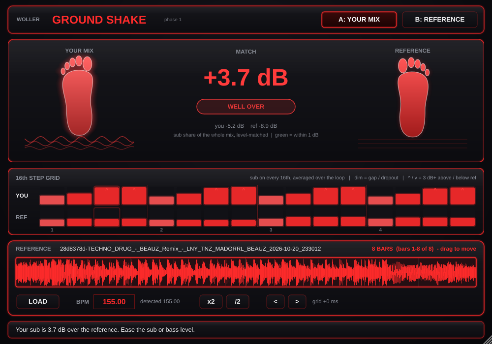

# WOLLER Ground Shake (Phase 1)

A meter for the end of your master chain. It answers one question: **if you were standing on a club floor, how much would your feet feel this sub, and does it match your reference track, every 16th of the way?**



## What's in Phase 1

| Part | What it does |
|---|---|
| **Two feet** | Left = your mix, right = the reference. Each shakes with its sub. Your foot's colour shows the match: **green** within 1 dB, **yellow** 1–3 dB off, **blue** well under, **red** well over. |
| **Match readout** | The difference in dB. Both tracks are measured as the sub's share of the whole mix, so a louder master doesn't fool it. |
| **16th step grid** | Sub energy on each of the 16 steps, averaged over the loop, for you and the reference. Dim cells = gaps or dropouts; ^ / v = a step 3 dB or more above / below the reference. |
| **Reference** | LOAD (or drag and drop) a WAV, AIFF or MP3. Its waveform shows an **8-bar window** you drag along; it snaps to bars. |
| **Tempo** | BPM and downbeat are detected on load. **x2 / /2** fix half/double tempo, type an exact BPM in the box, **< >** nudge the grid 10 ms (Shift-click = one 16th). |
| **A / B** | Flip between your mix and the reference. The reference is **level-matched** to your mix, so loudness can't fool your ears. |
| **Pass-through** | On A, audio passes through completely untouched. |

Zones: feel 20–60 Hz, punch 60–120 Hz (punch counts half). Auto zones from the reference, the checklist, fixes list, Match button and other checks come in Phase 2.

## Use it in Ableton

1. Put **Ground Shake** as the **last device on the Master**, after your limiter.
2. Loop 8 bars and press play. Ground Shake follows Ableton's tempo and bar position.
3. Load a reference and drag the 8-bar window over the part you want to compare, like the drop.
4. Watch your foot's colour and the step grid; press **B** to hear the reference at the same loudness.

## Get the Mac plugin (GitHub build)

1. Create a new **private** GitHub repository, for example `GroundShake`.
2. Upload everything in this folder (`Source`, `Tools`, `CMakeLists.txt`, `README.md`, `screenshot.png`). The hidden `.github` folder often gets skipped by the browser: add it with **Add file → Create new file**, named `.github/workflows/build.yml`, and paste in the contents of `build.yml`.
3. Open the **Actions** tab and wait for the green check (about 10 minutes).
4. Download **GroundShake-macOS**, unzip it, then double-click **GroundShake-VST3-mac.zip**.
5. Move **Ground Shake.vst3** into `~/Library/Audio/Plug-Ins/VST3/`, then in Terminal:
   ```
   xattr -cr ~/Library/Audio/Plug-Ins/VST3/"Ground Shake.vst3"
   ```
6. In Ableton: **Settings → Plug-Ins**, hold **Option** and click **Rescan**. It appears under **Plug-Ins → WOLLER → Ground Shake**, next to White Noise.

The build is universal (Apple Silicon and Intel). `GroundShake-AU-mac.zip` holds the Audio Unit version for Logic.

## Build locally

Requires CMake 3.22+ and a C++17 compiler (Xcode on Mac). JUCE downloads automatically.

```
cmake -B build -DCMAKE_BUILD_TYPE=Release
cmake --build build --config Release
```

Optional test tools: `-DGS_BUILD_ANALYSIS_TEST=ON` builds `GroundShakeAnalysisTest` (prints BPM, downbeat and the step profile of audio files) and `GroundShakeRenderTest` (drives the plugin with a fake host and saves a screenshot).

## Licence note

Built with JUCE (AGPLv3 or JUCE's commercial licences). Fine for personal use; check JUCE's licence before selling it.
